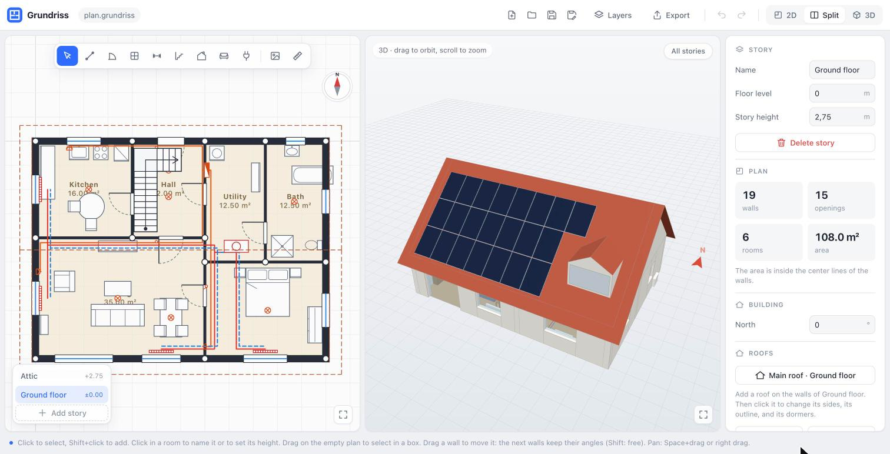
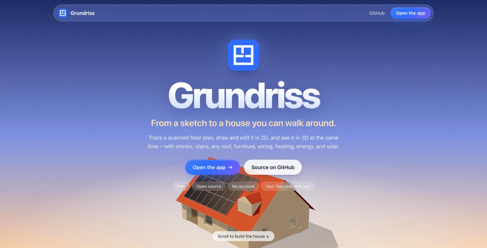

<p align="center">
  
</p>

<h1 align="center">Grundriss</h1>

<p align="center">
  <strong>From a sketch to a house you can walk around.</strong><br />
  Trace a scanned floor plan, edit it in 2D, and see it in 3D – in your browser.
</p>

<p align="center">
  <a href="https://andiwand.github.io/grundriss/app/"><strong>Open the app</strong></a> ·
  <a href="https://andiwand.github.io/grundriss/">Website</a> ·
  <a href="#use">Use</a> ·
  <a href="AGENTS.md">Develop</a>
</p>

<p align="center">
  
</p>

_Grundriss_ is the German word for a floor plan. The app runs fully in your browser. It needs no
account and no server, and your plans stay on your computer as files.

## Features

| Part          | What it does                                                                                                                                                                |
| ------------- | --------------------------------------------------------------------------------------------------------------------------------------------------------------------------- |
| **Trace**     | Load a scan or a photo of a plan. A neural network finds the walls, the doors, and the windows in the browser. OpenCV straightens and cleans the image.                     |
| **Draw**      | Walls with snapping and angles, doors and windows that open in a direction, dimensions, rooms with names and areas, and a check for objects that collide.                   |
| **3D**        | The 3D view shows the plan at the same time as you edit it. Click an object to select it, and drag furniture, doors, and windows to move them.                              |
| **Stories**   | Cellars, floors, and attics. Straight, L, and U stairs, and chimneys through all stories.                                                                                   |
| **Roofs**     | Gable, half-hip, hip, shed, flat, or each side on its own, on any outline. Dormers and roof windows. The attic walls stop at the roof, and the attic shows its living area. |
| **Furniture** | Generic pieces, the Kenney Furniture Kit, models from Poly Haven, and your own glTF files.                                                                                  |
| **Utilities** | Water, heating, electricity, and network, phone, TV, and SAT: devices, pipes, and cables, with their lengths.                                                               |
| **Energy**    | The layers of the envelope, U-values, the heat loss of each room, the climate of the location, solar panels, and an hourly balance with a battery.                          |
| **Renovate**  | Variants with measures or another floor plan, an estimate of their cost, the subsidy, the saving per year, and the payback time.                                            |
| **Export**    | PDF at 1:50 or 1:100, SVG, DXF, glTF, and one `.grundriss` package with everything.                                                                                         |

<p align="center">
  <a href="https://andiwand.github.io/grundriss/">
    
  </a>
</p>

## Use

The app starts with the **Projects** page: start a new plan, open a file, open a plan of this
browser, or open the example house. With an open plan, the top bar has six topics. Each topic
shows its own tools, panel, and layers. A click on **‹ Grundriss** at the top left closes the plan and goes back.

- **Overview**: the contents of the open plan. A click on a part opens it in its topic.
- **Structure**: the background and the tracing, walls, doors, windows, stairs, chimneys, stories,
  and roofs.
- **Utilities**: water, heating, electricity with PV, and communication.
- **Interior**: furniture and rooms.
- **Energy**: the location, the map, the climate, the insulation, the heated stories, the
  heating and the hot water per year, and the hourly balance of electricity.
- **Renovation**: variants of the building with measures or another floor plan, their cost, and
  their payback.

Select, Pan, and Measure are in all topics. The shortcut of a tool opens its topic. **?** shows
all keyboard shortcuts.

The app is in English and in German, with the decimal comma in German. It follows the language
of the browser; the language button in the top bar switches it.

### Phone and tablet

In a narrow window, the app shows the 2D plan or the 3D view alone. The topics are in a bar at
the bottom, and **⋯** in the top bar has the files, the layers, the export, and the help. The
panel is a sheet at the bottom: tap its handle for more or less, or drag it. A selection opens
the sheet.

- One finger draws with the active tool, moves an object, or pans the empty plan. A tap on a
  room selects the room. A finger next to a thin object, for example a window, selects it.
- Two fingers zoom and pan the 2D plan. In 3D, one finger turns the view, and two fingers zoom
  and pan.
- A drawing tool shows **Done**: it ends the tool, in place of Esc and Enter.

### Notes and photos

A wall, a door, a window, a device, a line, a piece of furniture, a stair, a chimney, and a room
have **Notes and photos** in their panel: a text, for example a defect or a year, and photos. On
a phone, **+ Photo** opens the camera or the gallery. A photo becomes at most 1600 pixels large,
so that the plan stays small. The plan file keeps the notes.

### Projects in the browser

The open plan saves itself in the browser after each change, as a project. The Projects page
shows each project with a picture of its ground floor; a click opens it. The buttons on a tile
change its name, make a copy, or delete it. A deleted project goes to the **Trash** for 30
days, and **Restore** brings it back.

The projects stay in this browser on this device. Clearing the data of the site deletes them.
Safari deletes the data of a site after 7 days without a visit, unless the app is installed. The
page warns about this, and when the storage is almost full. **Back up all projects** saves all
plans as one ZIP file, and **Restore a backup** reads it again. **Save** a plan to a file to
share it.

If a plan is open in two tabs, only the first tab saves it in the browser. The second tab says
so in the status line.

A large photo of a plan becomes smaller when it loads: at most 4000 pixels on its long side, as
a JPEG. The undo keeps the last 200 steps.

### Install the app

Grundriss is a Progressive Web App. In Chrome or Edge, click **Install** in the top bar, or use
the install button of the address bar. In Safari on iOS or macOS, use **Share › Add to Home
Screen** or **File › Add to Dock**. The installed app opens in its own window, starts without the
internet, and opens `.grundriss` and `.json` files. OpenCV and the recognition (about 28 MB)
download at their first use, and work offline after that. The climate and the map need the
internet.

### Steps

1. In **Structure**, click **Background** and choose a scan or a photo of a plan.
2. Optional: straighten and clean the image, and let the app suggest the walls. See
   [Assisted tracing](#assisted-tracing).
3. Click two points with a known distance between them, for example the ends of a wall. Type
   the real length and click **Apply**.
4. Select the **Wall** tool and click the corners of the walls. A click on a corner or on a wall
   ends the chain.
5. Select **Door** or **Window** and click on a wall. A door opens to the side of the wall where
   you click; a window opens into the room. The opening goes to the nearest free place on the
   wall, so that it does not overlap another opening. The panel sets how it opens (a hinged
   leaf, sliding, or fixed), one or two leaves, the hinge, and the swing. A window wider than
   1 m gets two leaves.
6. Select **Measure** to add a dimension line: click the two ends, then click where the line goes.
7. With **Select**, click or drag a box to select objects, and drag them to move them. When you
   drag one wall, the next walls keep their angles. The panel on the right shows the values of
   the selection.
8. Use the list at the bottom left to add a story, an attic, or a cellar, and to switch between
   the stories. The walls of the story below show as dashed lines, so you can draw on top of
   them. Each story has its own background.
9. Select **Stair** and click the bottom and the top of the run. The stair goes up to the next
   story. The panel changes it to an L stair or a U stair with a landing. Select **Chimney**
   and click where it goes.
10. Click in a room to give it a name and its own clear height.
11. Click **Furniture** (I) and choose a piece. Click on the plan to place it. Near a wall, its
    back goes against the wall. R turns it, and the panel sets its size.
12. In **Utilities**, click **Water**, **Heating**, **Electricity** (E), or **Communication**, and
    choose a device or a line. A device for a wall goes against the wall. A line connects to
    devices of its system; a double click ends it. The **Layers** menu shows or hides each
    system, PV, the insulation, the background image, and a map. Each topic keeps its own
    layers.
13. Without a selection, the panel shows the content of the topic. In **Structure**, it shows
    the story, the north direction, and the roof. Drag the
    compass at the top right to turn north.
14. Objects that collide have a red dashed outline: two doors or windows that overlap, an
    opening in a corner or higher than its wall, furniture in a wall, on a stair, or on another
    piece, and furniture in the way of a door or a window that opens. The panel of the object,
    and of Structure and Interior, lists the collisions; a click selects the other object. A
    chair can stand under a table, and a low piece under a window.
15. In the 3D view, click an object to select it, also on another story. Shift+click adds it to
    the selection. Drag a selected piece of furniture, device, stair, or chimney to move it on
    its floor, and a selected door or window to move it along its wall. The mouse over an object
    shows it in a color.
16. Click **Save** to write the plan to a file. **Export** writes a PDF, an SVG, a DXF, or a glTF
    model.

| Key                      | Action                                            |
| ------------------------ | ------------------------------------------------- |
| V, P, W, D, N, M, C      | Select, Pan, Wall, Door, Window, Measure, Scale   |
| Shift+click              | Add an object to the selection, or remove it      |
| Drag on the empty plan   | Select the objects in a box                       |
| Shift (wall tool)        | Keep the direction at a multiple of 45°           |
| Shift (drag a wall)      | Move the wall freely, so that the next walls turn |
| Alt                      | Turn off the grid and the snap of the direction   |
| Space + drag, right drag | Pan                                               |
| Two-finger scroll        | Pan on a trackpad. A pinch zooms.                 |
| Mouse wheel              | Zoom                                              |
| Arrow keys, Shift+arrow  | Move the selection by 5 cm or 50 cm               |
| Esc                      | Stop the current action or clear the selection    |
| Delete, Backspace        | Delete the selection                              |
| F                        | Show the whole plan                               |
| Ctrl/Cmd+C, X, V, D, A   | Copy, cut, paste, duplicate, select all           |
| Ctrl/Cmd+Z, Shift+Z      | Undo, redo                                        |
| Ctrl/Cmd+S, Shift+S, O   | Save, save as, open                               |

The wall tool snaps the direction of a wall to multiples of 15° when it is near one.

### Files

A plan is a `.grundriss` file. It is a ZIP file that contains:

- `plan.json`: the building with its stories.
- `backgrounds/`: the background image of each story as a separate file.
- `exports/`: a PDF with a page for each story, an SVG for each story, a DXF, and a glTF model,
  so that other programs can use them without Grundriss.

The app also opens and saves a plan as one `.json` file. That file contains the background image
as a data URL.

Chrome and Edge save to the same file again. Firefox and Safari download a new file each time.

### Report and quantities

**Export → Report (PDF)** gives one PDF: the areas of the rooms (net and WoFlV), the envelope with
its layers and U-values, the doors and the windows by size, the heat loss and the heat pump
readiness of each room, the energy per year, the summer, the variants of the renovation, the
building services, and then the plans of the stories. Give it to an energy advisor, a bank, or a
contractor.

**Export → Quantities (CSV)** gives a ZIP file with CSV files: the rooms, the openings, the areas
of the envelope, the materials of its layers (area and volume), and the building services. In
German, the files use ";" and the decimal comma, as German spreadsheets expect.

A device or a cable of electricity can have a **circuit**, for example F3. The distribution board
in Utilities lists the devices and the cable length of each circuit.

### Assisted tracing

The panel shows **Assisted tracing** when the plan has a background. These steps use OpenCV.js.
The browser downloads it (about 10 MB) the first time that you use one of them.

1. **Straighten**: click the four corners of the plan on a photo. The app corrects the
   perspective, so that the plan becomes a rectangle. Then set the scale again.
2. **Clean up**: the app removes the uneven light and the specks, and gives a black and white
   image. The slider sets the strength.
3. **Suggest walls**: the app finds the thick dark lines of the walls and shows them in green.
   Click a suggestion to reject it. Then click **Add walls**.

4. **Recognize plan**: a neural network finds the walls, the doors, and the windows. Doors show
   in orange and windows in blue. Click a suggestion to reject it. Then click **Add walls**.
   The network runs in your browser. The first time, the browser downloads about 15 MB.

The network learned only from synthetic plans that Grundriss generates. It can make mistakes on
real scans, so check the result. The suggestions of step 3 find walls with a solid fill. They do
not find walls drawn as two thin lines. A door gap stays open, so put a door in it and close the
wall. Undo removes each step.

### Colors

The 3D view shows each side of a wall in its own color. Click a room to set its **Wall color**:
the walls of the room show it on their room side. Without a selection, **Facade** sets the color
of the outside of the outer walls. A roof has a **Color** and an **Underside**. Click a wall to
give one side its own color, for example an accent wall; the × gives back the color of the room
or the facade.

### Roofs

Without a selection, the panel lists the roofs. **Gable**, **Half hip**, **Hip**, **Shed**, and **Flat** add a
roof on the outline of the walls of the active story. Click a roof to change it:

- **Sides**: each side of the outline is an **eave** (a face rises from it with its pitch), a
  **gable** (a vertical wall), or a **half hip**: a gable wall up to the height of its **gable
  wall**, and above it a small hip face with the pitch of the side. The plan shows the number of
  each side. The gable preset puts a gable at the end of each wing, and the half-hip preset a
  half hip.
- **Outline**: drag the corners on the plan. Drag a + in the middle of a side to add a corner.
  Select a corner and press Delete to remove it. A second roof, for example of a garage, can have
  its own outline.
- **Eave height**: by default the top of the walls of the story.
- **Dormers** and **roof windows** go on an eave side, at a position along the side and a
  distance from the eave.

### Energy and photovoltaic

The **Energy** and the **Renovation** topics show the 2D plan or the 3D view, and a wide panel for the calculations:
the inputs in one column and the results in the other. Split is not available there. Without a
selection, the panel shows the energy of the building:

- **Energy**: the heat loss of the building in kW and in W/m². The groups below set the layers of
  the outer walls, the roof, and the floor on the ground, the U-values of windows and doors, and
  the temperatures. A click on a room shows its heat loss and its heating. A click on a wall
  shows its U-value, and the wall can get its own layers.
- **Photovoltaic**: in **Utilities**, the Electricity group has the PV fields. **Add a PV field** fills the best face of the roof with panels. The field
  gives the number of panels, the peak power, and the yield per year. On a flat roof, the
  **Mounting** of a field is flat on the roof, a rack in one direction, or an east-west rack. A
  rack has its own tilt and direction. The rows of a rack in one direction keep a distance, so
  that a row does not shade the next row at noon on 21 December. An east-west rack puts two
  panels back to back, so half of the panels face each way. A new field on a flat roof gets a
  rack to the south with 15°.

### Location and climate

The **Location** group of **Energy** sets the place of the building: search a town, or type the latitude and
the longitude. **Load climate** then downloads the hourly weather of the last 10 complete years
from [Open-Meteo](https://open-meteo.com) and stores a typical year in the plan (about 40 kB). So
the plan works offline after that. The app sends the place to open-meteo.com only when you click
**Search** or **Load climate**.

The **Layers** menu can show a map under the 2D plan: OpenStreetMap, or the aerial photo of
[basemap.at](https://basemap.at) in Austria. The map lies at the location and turns with the
north direction. To fit the map to the plan, click **Move the map** in the Location group. Drag to move the map,
and Shift+drag to turn it around the place (this changes North). Esc or **Done** ends it. The
**Plan point x** and **y** of the location are the point of the plan at its latitude and
longitude, so you can also type them. The browser loads
the map only while it shows, because each request sends the place to the map server.

From the stored year, the app calculates:

- the PV yield of each face: the sun position for each hour, the Hay–Davies model for the
  irradiance on the tilted face, and losses for the angle, the cell temperature, and the system
  (14 %). The yield ignores shade.
- the mean temperature of each month, and the heating degree days G20/15.
- the design temperature: the coldest mean of 48 hours in the 10 years. The Energy panel can use
  it for the temperature outside.
- the heating per year: a monthly balance of the heat loss of the rooms, the sun through the
  windows (by their direction), and the internal gains (3.75 W/m²), in the spirit of EN ISO 13790. The Heating group of **Utilities** sets the heating (heat pump, boiler,
  district heating, or direct electric) and its efficiency. The **Heating per year** group of
  the Energy panel sets the price. It shows the heat demand,
  an efficiency class, the final energy, the cost, the CO₂, the heat demand of each month, and
  the part of the electricity that the PV can cover.
- the hot water: the **Hot water** group sets the people, the liters per person and day, and the
  heater (the heating, or direct electric). The water goes from 10 °C to 55 °C, and the storage
  and the pipes lose 40 % more. A heat pump has 80 % of its performance factor for hot water. The
  hot water adds to the final energy, the cost, and the CO₂, but not to the heat demand and the
  class.

A story can be **heated** or not: the check box in the panel of the story, or the **Heated
stories** group of the Envelope. A new cellar is unheated. An unheated story loses no heat, and
a heated room above or below it loses heat through the **slab to an unheated story**, with a
factor of 0.7 to a cold cellar and 0.9 to a cold attic. The walls of a heated cellar lose less
in the part that is in the ground.

The **Electricity** group sets the household electricity per year (without the heating and the
hot water), the battery, the price from the grid, and the payment for the feed-in. The price
from the grid is also the price of an electric heating. **Electricity per year** is an hourly
balance of the typical year: the PV of each hour against a usual day of a household, the heating
by the temperature of the hour, and the hot water from 6:00 to 22:00. The battery charges with
the surplus and loses 5 % each way. The balance gives the PV used in the building, the part of
the electricity from the PV, the grid, and the **energy cost per year**: the electricity from
the grid, minus the feed-in, plus the fuel of a heating without electricity.

### Renovation

The **Renovation** topic compares the plan with variants. **Add a variant** makes a copy of the
plan, or a variant with one measure: more insulation on the walls, the roof, or the slab, triple
glazing, a heat pump, PV on the best free face, a battery of 10 kWh, or a heated or unheated
cellar. **Add a measure** adds more measures to a variant. A variant keeps the envelope, the
heating, the hot water, the heated stories, the household with the battery, and the PV fields.
Walls with their own layers stay as in the plan.

Each variant shows its energy cost per year, its heat demand and class, its CO₂, the saving per
year against the plan, and the payback time. The **cost** is an estimate from usual prices in
Austria or in Germany, 2025 (**Prices**), without the scaffold; the Estimate list shows its
items. Type the price of a real offer to replace it, and the **subsidy** to take it off. For
Germany, a button fills in an estimate of the federal subsidy (BEG EM, 2025: a heat pump 30 %,
20 % more for a replaced oil or gas heating, 5 % more for a ground source; insulation and
windows 15 %; without the bonus for the income and the iSFP). For Austria, the programs change
too often for an estimate: see umweltfoerderung.at and the programs of your state. The payback
time is the first year where the savings pay the cost after the subsidy. The saving of each
year grows with **Energy prices**, and **Interest** discounts it.

**Open** a variant (the cube on its card, or the switch next to the file name in the top bar) to
see and change it in all topics: its insulation and heating, but also its walls, doors, rooms,
and furniture. The changes go into the variant, and the plan stays as it is. **Add a variant →
Another floor plan** makes a new variant and opens it in Structure, for example to try which
walls to remove. A variant with its own floor plan shows its rooms, and its estimate has the
walls to remove and to build, the cuts for new openings, the new doors and windows, and the
openings to close. If a wall to remove can carry a load (an outer wall, a wall under a wall of
the story above, or a wall of 24 cm or more), the card asks you to talk to a structural engineer.
A variant without its own floor plan follows the floor plan of the plan. The check mark makes a
variant the new plan. Undo goes back.

### Heat loss, heat pump, and summer

The heat loss counts the thermal bridges (**ΔU** on all areas of the envelope), the air change,
the airtightness **n50**, and the **heat recovery** of a ventilation system. Roof windows and the
windows of dormers count as windows, with their sun. The room labels show the net area inside
the walls. The energy per m² uses the gross floor area of the heated stories (BGF), and the WoFlV
living area uses the net area.

A heat pump has the source **outside air** or **ground**. The app calculates its performance in
each hour from the flow temperature, which follows a heating curve, and the temperature of the
source (Carnot × 0.40 for air, × 0.45 for ground). The design flow comes from the radiators, or
you set it. A **fixed performance factor** is still possible. **Heat pump readiness** lists the
flow temperature that the radiators of each room need for its heat loss: the power of a radiator
is its power at 75/65/20 °C (EN 442), with the exponent 1.3, and floor heating gives 70 W/m² at
35 °C. Up to 45 °C is good for a heat pump, and up to 55 °C is fair.

**Summer** checks each room against overheating, hour by hour in June to August: the sun through
its windows, people and devices, and windows that open when the outside is cooler. The verdict
uses the degree hours over 27 °C (1200 K·h is the limit for homes in DIN 4108-2). **External
blinds** show their effect.

The PV yield counts the shade of the roofs, the dormers, and the chimneys, hour by hour. Trees,
neighbors, and walls do not count.

Without a climate, the PV yield is a general estimate for Central Europe.

The values are estimates for planning. They are not a calculation by a standard and not an
energy certificate.

### Furniture sources

- **Generic**: simple shapes that the app makes, with any size.
- **Kenney**: the [Furniture Kit](https://kenney.nl/assets/furniture-kit) by Kenney, CC0 1.0. The
  app contains it, so it works offline.
- **Poly Haven**: realistic models from [polyhaven.com](https://polyhaven.com), CC0 1.0. The app
  asks Poly Haven for the list and downloads a model when you choose it. The plan file then
  contains the model.
- **Imported**: your own `.glb` files, or `.gltf` files with embedded data. Check the license of
  each model yourself.

## Develop

```sh
npm ci
npm run dev        # the app on http://localhost:5173/
npm run dev:site   # the website
npm test
npm run build      # the website in dist/ and the app in dist/app/
```

See [`AGENTS.md`](AGENTS.md) for the architecture and the conventions. On `main`, the workflow
`.github/workflows/pages.yml` deploys the website and the app to GitHub Pages.

## Credits

The furniture models come from [Kenney](https://kenney.nl) and [Poly Haven](https://polyhaven.com)
(both CC0). Weather data by [Open-Meteo.com](https://open-meteo.com) (CC BY 4.0). The free
Open-Meteo API is for non-commercial use. Map tiles © [OpenStreetMap](https://www.openstreetmap.org/copyright)
contributors, and aerial photos by [basemap.at](https://basemap.at) (CC BY 4.0). Grundriss uses [Three.js](https://threejs.org), [OpenCV.js](https://opencv.org),
[ONNX Runtime Web](https://onnxruntime.ai), and [fflate](https://github.com/101arrowz/fflate).

## License

[MPL-2.0](LICENSE)
